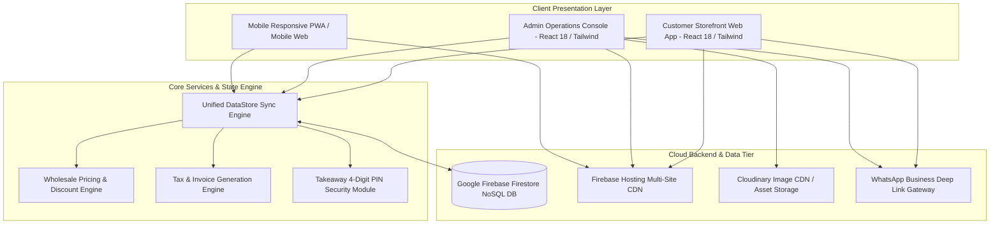
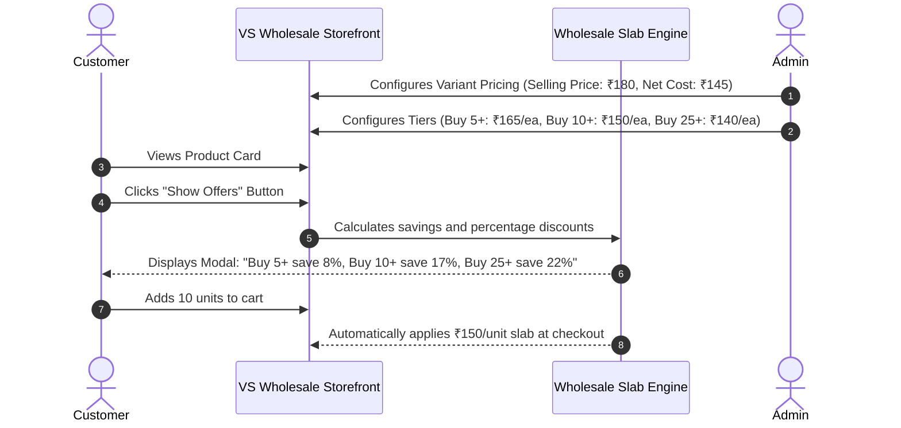
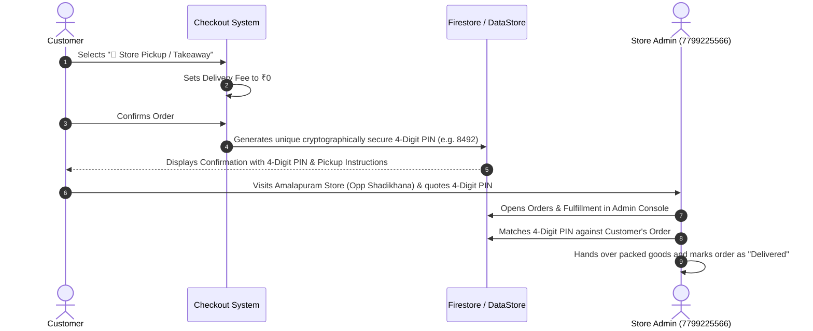

# Project Documentation & Client Quotation Proposal
## Project: VS Wholesale — Hybrid B2B & B2C E-Commerce & Distribution Platform
**Client / Brand**: Varshitha Sudarshan Agencies (VS Wholesale)  
**Location**: Opp Shadikhana, Main Road, Amalapuram, Andhra Pradesh — 533201  
**Contact**: +91 7799448865 (WhatsApp / Direct Call)  
**Prepared By**: Technical Architecture & Engineering Team  
**Date**: November 2026  
**Document Version**: 2.0 (Production Release)

---

## 1. Executive Project Overview

**VS Wholesale** is a specialized, production-ready hybrid e-commerce and wholesale operations management platform designed specifically for wholesale FMCG, grocery distributors, and retail consumers. The platform bridges the gap between bulk wholesale mandi trade and fast doorstep/takeaway retail fulfillment.

### 1.1 Business Goals
1. **Direct Wholesale Tier Savings**: Provide dynamic quantity-based discount slabs (e.g., 5+, 10+, 25+ units) to incentivize bulk buying from retailers, kirana stores, hotels, and large families.
2. **Dual Fulfillment Model**: Offer both rapid **Doorstep Express Delivery** and **In-Store Self-Pickup (Takeaway)** with a fraud-proof **4-Digit Verification PIN** system.
3. **Internal Profit & Loss Intelligence**: Enable store administrators to track the exact **Net Cost (Purchase Price)** of every item and compute live Profit/Loss margins without ever exposing confidential cost data to public customers.
4. **Zero-Friction Customer Experience**: Fast mobile login via 10-digit mobile number, instant WhatsApp customer support, and automatic GST-compliant invoice generation.
5. **Real-Time Operational Center**: Comprehensive admin console for catalog management, stock audits, low-inventory alerts, order packing workflows, and instant CSV data export.

### 1.2 Live Deployment Endpoints
- **Customer Web Storefront**: [https://vs-wholesale.web.app](https://vs-wholesale.web.app)
- **Admin Operations Console**: [https://vs-wholesale-admin.web.app](https://vs-wholesale-admin.web.app)
- **Source Code Repository**: [https://github.com/sriramjayanti/ecommerce-platform](https://github.com/sriramjayanti/ecommerce-platform)

---

## 2. System Architecture & Tech Stack

### 2.1 Technology Stack Details
- **Frontend Framework**: React 18 with TypeScript for type-safety and performance.
- **Monorepo Architecture**:
  - `apps/web`: High-performance customer e-commerce storefront.
  - `apps/admin`: Enterprise operations, inventory, and order fulfillment dashboard.
  - `packages/shared`: Shared types, constants, pricing engines, and real-time data sync layer.
- **Styling & UI**: Tailwind CSS with custom responsive layouts optimized for mobile and desktop screens.
- **Cloud Database**: Google Cloud Firestore with real-time listeners and offline caching.
- **Hosting & CDN**: Google Firebase Hosting Multi-Site (SSL certified, edge cached).
- **Media & Asset Management**: Cloudinary CDN with preset fallbacks and multi-source uploader.
- **Iconography**: Lucide React high-resolution vector icon library.

---

## 3. User Roles & Access Control Matrix

| Feature / Action | Customer (Public) | Warehouse Staff | Super Admin (7799225566) |
| :--- | :---: | :---: | :---: |
| Browse Catalog & Categories | Allowed | Allowed | Allowed |
| View Retail Selling Price (MRP & Discounted Price) | Allowed | Allowed | Allowed |
| View Wholesale Discount Slabs ("Show Offers") | Allowed | Allowed | Allowed |
| **View Net Cost (Purchase Price) & Profit/Loss** | **Hidden** | **Hidden** | **Exclusive Full Access** |
| Place Order (Express Delivery / In-Store Takeaway) | Allowed | Allowed | Allowed |
| Receive 4-Digit In-Store Pickup Code | Allowed (Takeaway Only) | Allowed | Allowed |
| **Verify & Approve 4-Digit Takeaway PIN** | Denied | Allowed | Allowed |
| Update Order Fulfillment Status (Pack/Dispatch/Deliver) | Denied | Allowed | Allowed |
| Edit Products, Inventory & Wholesale Slabs | Denied | Denied | Allowed |
| Low Stock Alerts & Inventory Movement Logs | Denied | View Only | Full Control |
| Export Accounting & Sales Reports (CSV) | Denied | Denied | Allowed |
| Configure Store Settings, Banners & Feature Flags | Denied | Denied | Allowed |

---

## 4. End-to-End Operational Workflows

### 4.1 Wholesale Tier Pricing & "Show Offers" Workflow

### 4.2 In-Store Takeaway (Self-Pickup) 4-Digit PIN Verification Workflow

### 4.3 Net Cost (Profit & Loss) Calculation Workflow (Admin Only)
1. **Data Entry**: When creating or editing any product variant, Admin inputs:
   - **MRP** (Maximum Retail Price, e.g. ₹220)
   - **Selling Price** (Store retail price, e.g. ₹185)
   - **Net Cost Amount** (Store acquisition / mandi purchase cost, e.g. ₹140)
2. **Security Isolation**:
   - The field `netAmount` is never emitted in public catalog API responses.
   - Only authenticated admin sessions can view margin comparisons.
3. **Live Profit Metric**:
   - Admin UI displays: `Margin = Selling Price - Net Cost` (e.g. ₹185 - ₹140 = **+₹45 profit / 24.3% margin**).
   - In case of promotional discounts below net cost, the system displays an alert: `Loss Warning (-₹X)`.

### 4.4 Inventory & Stock Audit Workflow
- Every stock adjustment creates an immutable log with `Timestamp`, `Variant ID`, `Previous Stock`, `New Stock`, and `Reason`.
- Automatic visual badges:
  - Stock > 15: `HEALTHY (Green)`
  - Stock 1 to 15: `LOW STOCK WARNING (Amber)`
  - Stock = 0: `OUT OF STOCK (Red)`
- Dedicated **Low Stock Warning CSV Export** in one click for warehouse restocking.

---

## 5. Key System Modules & Features

### 5.1 Storefront (Customer Facing)
- **Responsive Navigation**: Top notification banner, prominent category mega-menu, live fuzzy search across all items, quick pincode switcher (Amalapuram 533201 default).
- **Product Catalog**: High-resolution imagery, brand filters, category pills, stock status indicators, star ratings, and assured quality tags.
- **Wholesale Tier Showcase**: Visual "Show Offers" popup showing exact tiered volume savings.
- **Smart Shopping Cart Drawer**:
  - Live subtotal and wholesale discount breakdown.
  - Delivery fee calculator with free delivery threshold alert (₹499+).
  - One-click checkout access.
- **Checkout Process**:
  - Delivery address input with landmark and contact number.
  - Fulfillment option selector: **Doorstep Delivery** vs. **Store Pickup / Takeaway**.
  - Payment options: UPI (GPay/PhonePe/Paytm QR), Netbanking, Credit/Debit Cards, Cash on Delivery.
- **Order Tracking & Tax Invoices**:
  - Visual 3-stage tracking: Order Confirmed → Dispatched → Delivered.
  - For Takeaway orders: Prominent 4-digit verification code tile.
  - Print-ready official GST Tax Invoice containing HSN code, itemized tax rates, agency registration details, and authorized signature.
- **Direct WhatsApp Support**: Instant one-click chat with store customer care (`+91 7799448865`).

### 5.2 Admin Console (Business Operations)
- **Mobile-Adaptive Layout**: Auto-collapsing hamburger navigation, space-saving 2-column KPI cards for mobile administration on smartphones.
- **Executive KPI Dashboard**: Total gross revenue, order volume, active customer count, delivered fulfillment rates.
- **Product & Pricing Engine**: Multi-image uploader (device upload + Cloudinary), Net Cost field, wholesale tiered slab creator, SKU and barcode support.
- **Order Management & Fulfillment**: Real-time incoming order queue, filter by status, 4-digit Takeaway PIN verification modal, customer contact actions.
- **Reports & Data Export Center**:
  - Orders Report CSV.
  - Product Sales Performance CSV.
  - Period Summary CSV (Daily / Weekly / Monthly).
  - Low Stock Warning Restocking CSV.
- **Promotional Banner Studio**: Slide transition animations (horizontal slide, smooth fade, zoom), autoplay interval duration controls, target redirection links.
- **Feature Flags**: Instant toggle switches for coupons, reviews, ratings, wholesale pricing, and emergency maintenance mode.

---

## 6. Client Requirements & Prerequisites Checklist

To hand over and maintain the platform smoothly, the following infrastructure accounts and assets are required from the client:

| Resource | Purpose | Recommended Tier | Status |
| :--- | :--- | :--- | :---: |
| **Domain Name** | Custom domain (e.g. `vswholesale.in` or `vswholesale.com`) | GoDaddy / Namecheap | Optional (Current: `vs-wholesale.web.app`) |
| **Google Firebase Account** | Hosting, Firestore Database, Authentication | Blaze Plan (Pay as you go - free tier generous) | Configured |
| **Cloudinary Account** | Cloud-based media storage for product and banner images | Free / Plus Tier | Configured |
| **WhatsApp Business Number** | Direct customer communications and order updates | Active SIM (`7799448865`) | Active |
| **Payment Gateway Account** (Optional for auto-settlement) | Razorpay / Cashfree / PhonePe PG for automated settlements | Business KYC Account | Integrated via UPI/COD/Manual; PG optional |
| **Admin Device** | Smartphone (Android/iOS) or PC/Laptop for managing orders | Any modern browser | Supported |

---

## 7. Project Quotation & Commercial Breakdown

### 7.1 Scope of Deliverables
1. Complete Source Code repository with full ownership rights.
2. Production Deployment on Google Firebase Hosting Multi-Site:
   - Storefront: `https://vs-wholesale.web.app`
   - Admin Center: `https://vs-wholesale-admin.web.app`
3. Integrated Google Cloud Firestore database configuration with security rules.
4. Mobile-optimized responsive designs for smartphone operations.
5. Automated GST Tax Invoice generation templates.
6. 4-Digit In-Store Takeaway verification module.
7. Admin Net Amount & Profit/Loss calculation engine.
8. Comprehensive Admin & User Documentation, including video/walkthrough guide.

### 7.2 Quotation Milestone Schedule

| Milestone # | Phase Description | Scope & Deliverables | Timeline | Price (INR) |
| :---: | :--- | :--- | :---: | :---: |
| **M1** | **UI/UX Design & Storefront Architecture** | Mobile-first storefront, category catalog, product detail page, cart drawer, pincode checker, WhatsApp integration. | Completed | ₹35,000 |
| **M2** | **Wholesale Pricing & Discount Engine** | Quantity-based wholesale slabs, "Show Offers" modal, dynamic price calculations, tiered discounts. | Completed | ₹25,000 |
| **M3** | **Admin Operations & ERP Console** | Executive metrics, mobile-adaptive layout, 2-column KPI cards, product CRUD, Net Cost & Profit/Loss calculator. | Completed | ₹35,000 |
| **M4** | **Dual Fulfillment & Security Module** | In-Store Takeaway 4-digit code generator, admin PIN verification modal, Doorstep Express delivery logic. | Completed | ₹20,000 |
| **M5** | **Inventory Management & CSV Reporting** | Stock logs, low-stock alerts, 4 CSV export reports (Orders, Product Sales, Aggregated Summaries, Low Stock). | Completed | ₹15,000 |
| **M6** | **Tax Invoice Engine & Brand Customization** | Rebranding to VS Wholesale, Amalapuram address integration, GST Tax invoice printing with HSN slabs, no-email contact. | Completed | ₹15,000 |
| **M7** | **Cloud Deployment, Testing & Handover** | Multi-site Firebase deployment (`vs-wholesale.web.app`), GitHub repository sync, user guide & 30-day warranty. | Completed | ₹15,000 |
| **TOTAL** | **Full Turnkey E-Commerce & Wholesale Solution** | **Complete Intellectual Property Handover** | **7 Milestones** | **₹1,60,000** |

> *Note: Taxes (GST @ 18%) applicable as per statutory regulations if tax invoice is required.*

### 7.3 Annual Maintenance & Support Packages (Optional)
- **Basic SLA (₹3,000 / month)**:
  - Monthly database backups and uptime monitoring.
  - Minor text, banner, and setting updates.
  - Bug fixes and technical support via WhatsApp.
- **Growth SLA (₹6,500 / month)**:
  - Basic SLA features included.
  - Cloud database scaling management.
  - Seasonal promotional banner redesigns.
  - Payment gateway API updates and security audits.

---

## 8. Terms of Engagement & Next Steps

1. **Approval**: Client signs or accepts this scope of work and quotation.
2. **Access Handover**: Transfer of Firebase ownership and repository permissions to client's Google Account.
3. **Training Session**: 1-hour live remote or in-person demonstration of the Admin Portal for store staff.
4. **Warranty Period**: 30 days of free complimentary post-launch support and defect fixes.

---
**Authorized Signatory**  
For Technical Solutions Team  
*(VS Wholesale Platform Development)*
